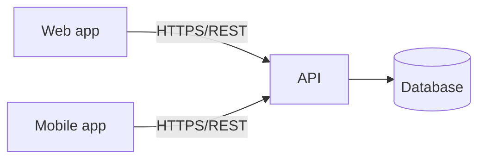

# Architecture

## Overview
{{2–3 paragraphs.}}

## Components
| Component | Responsibility | Tech | Repo |
|---|---|---|---|

## Key flows
### {{Flow name}}

## Data
## Cross-cutting concerns
Authentication · logging · error handling · localization

## Key decisions
{{Or link to adr/ at full level.}}
